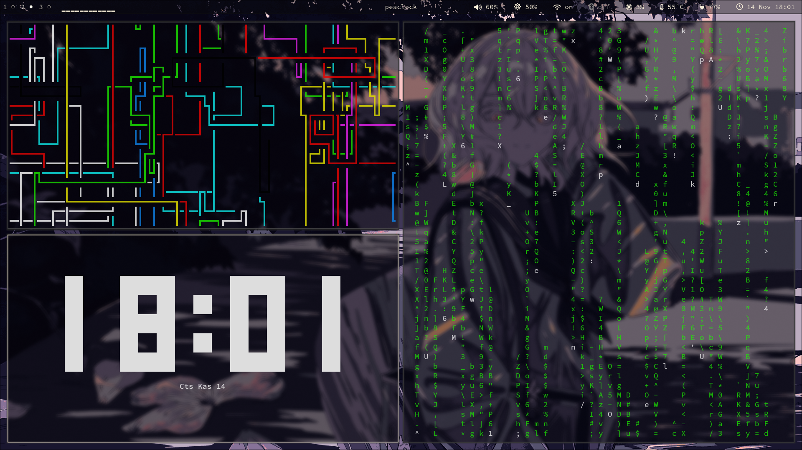
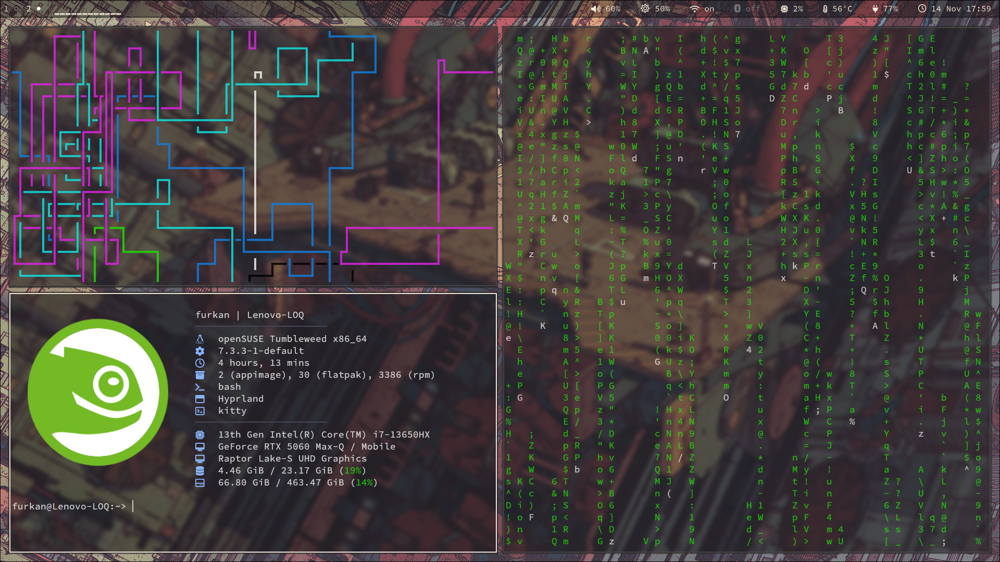

# Duskfall Dotfiles

A minimalist Hyprland setup for openSUSE Tumbleweed. Copy the configs into `~/.config/` and `~/.local/`, or let the install script do it for you. Everything is plain text, so edit freely and make it your own.



> [!IMPORTANT]
> - Only tested on **openSUSE Tumbleweed**. `install.sh` relies on `zypper`, so it will not work on other distributions.
> - The config uses Hyprland's **new Lua format**. Older Hyprland versions cannot read it (requires Hyprland `<0.57.2>` or newer).
> - Having a KDE Plasma environment installed is recommended. Other environments are untested, and you use and modify these dotfiles at your own risk.

## Components

| Role | Software |
|---|---|
| Window manager | [Hyprland](https://hyprland.org/) |
| Bar | Waybar |
| Launcher | Rofi |
| Terminal | Kitty |
| Notifications | Dunst |
| Power menu | Wlogout |
| Wallpaper manager | Waypaper |



## Installation

### Automatic (recommended)

```bash
git clone https://github.com/furkan-zxc/Duskfall-Dot.git
cd Duskfall-Dot
chmod +x install.sh
./install.sh
```

The script installs all required dependencies via `zypper` and copies the configs into place.

**Safe by default:** existing configs are backed up to `~/.config-backup-<date>`, and files you already have are never overwritten.

### Manual

```bash
git clone https://github.com/furkan-zxc/Duskfall-Dot.git
cd Duskfall-Dot
mkdir -p ~/.config ~/.local/bin
cp -r config/. ~/.config/
cp -r local/bin/. ~/.local/bin/
chmod +x ~/.local/bin/*.sh
```

> [!NOTE]
> The manual method does **not** create a backup. Back up your existing `~/.config` first if you need to.

## Keybindings

| Shortcut | Action |
|---|---|
| `SUPER + T` | Open terminal (Kitty) |
| `SUPER + R` | Open launcher |
| `SUPER + PRTSCR` | Take a screenshot |
| `SUPER + SPACE` | Toggle floating |
| `SUPER + SHIFT + R` | Start screen recording |
| `SUPER + S` | Toggle special workspace |
| `SUPER + ESC` | Power menu (Wlogout) |

## Customization

All configs live in `~/.config/`. Edit them directly, and reload Hyprland (`hyprctl reload`) to apply changes.

## License

MIT. Third-party files (themes, wallpapers, etc.) keep their original licenses.
